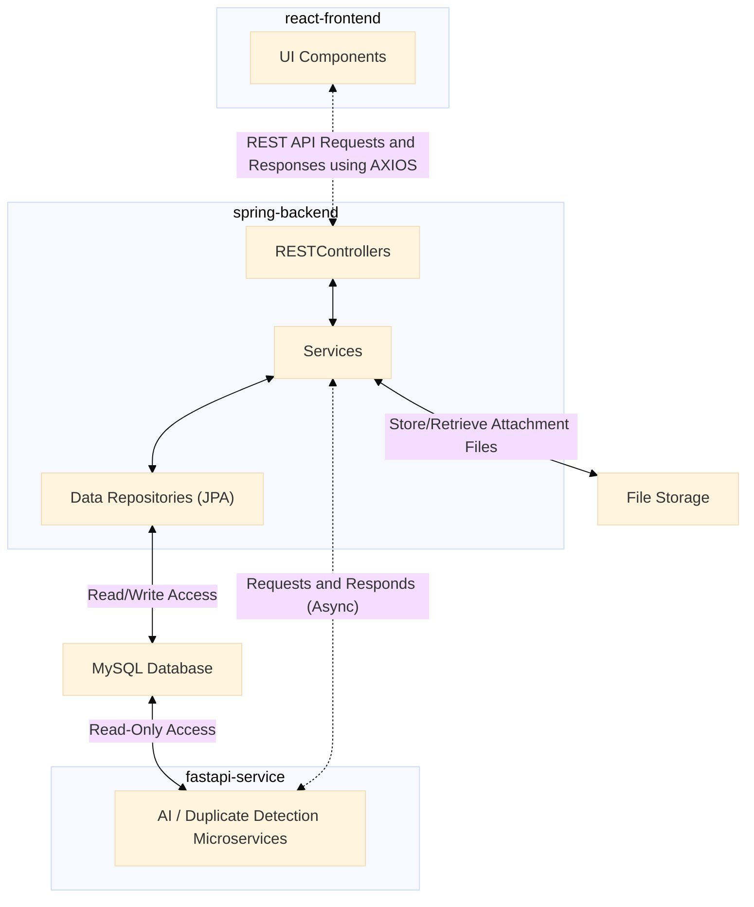
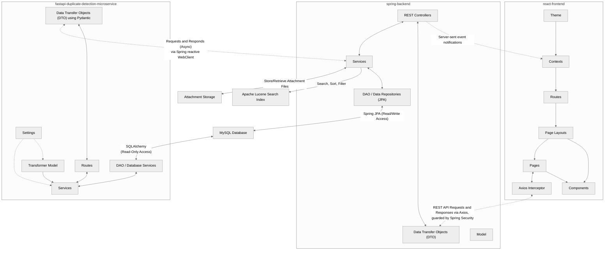

# High Level System Architecture Diagram

> This file contains a __High-Level System Architecture Design Diagram__ for this project. Note: Since GitLab only supports an older version of Mermaid, the configuration of this diagram is adapted for it to appear on GitLab. The original diagram was included in the Interim Report.

## Bulked Up Version for Dissertation
Due to GitLab rendering limitations for mermaid, this may look a bit sad, but it looks better in the dissertation so don't worry. This file mainly serves the purpose of saving the chart source code.

