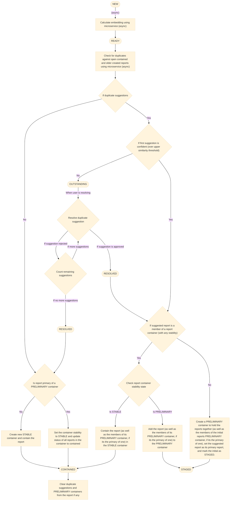

# Duplicate Detection Lifecycle Flow Diagram

> This is my flow design for using duplicate detection to contain bug reports into groups. This would help find up-to-date duplicate suggestions while keeping up with new incoming reports and new containers (changes to the corpus).

