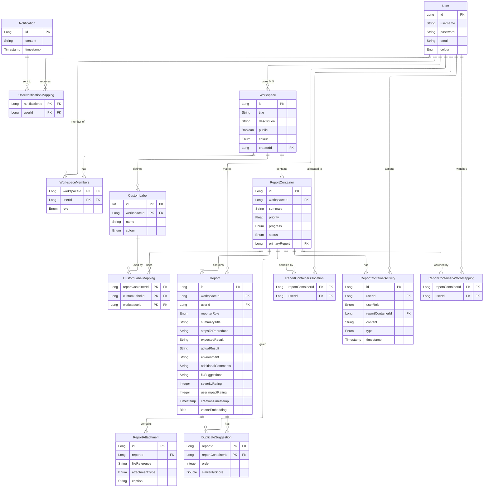
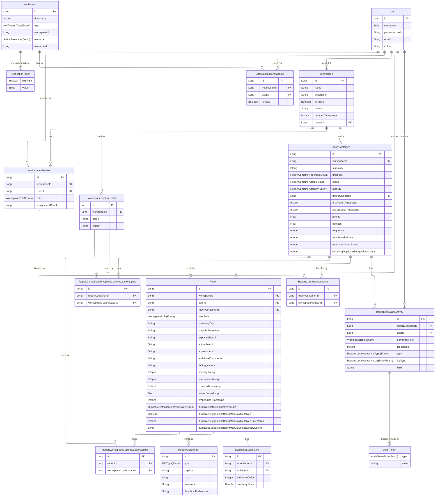

# Entity Relationship Diagram

> This file contains the __Entity Relationship Diagram (ERD)__ for this project, originally created as part of the Interim Report. Note: Since GitLab only supports an older version of Mermaid, the configuration of this diagram is adapted for it to appear on GitLab. The original ERD diagram was included in the Interim Report.

## Updated Diagram for Dissertation

